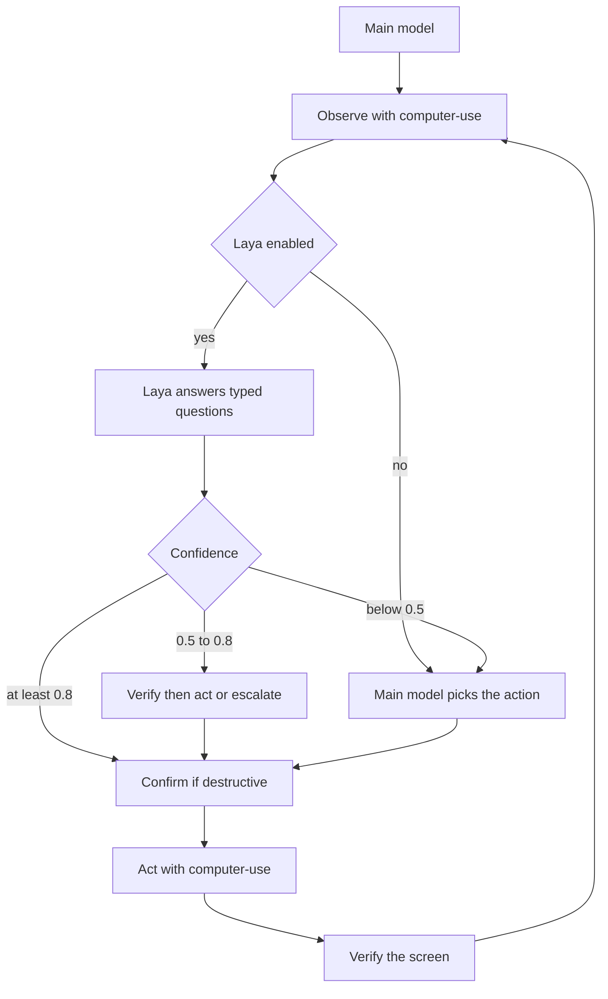

# smart-computer-use

Agent skill for desktop computer use. A harness such as OpenCode, Claude Code, Codex, Cursor, or Gemini CLI loads the skill, observes the screen, and drives the mouse and keyboard through the [`computer-use`](https://github.com/lindoelio/computer-use) CLI.

The CLI is a separate project. This repository is the skill: instructions, setup scripts, and reference docs. There is no Rust code here.

Skill version **0.2.0**, targeting **computer-use 0.2.0**. 0.2.0 is what makes element targeting possible: a numbered accessibility tree per window, acting by element index instead of blind coordinates, post-action state in the same call, input tiers, a policy subsystem with an audit log, OCR, and Chrome DevTools Protocol attach.

Laya, a local typed decision model, is optional and experimental. The skill works with the CLI and the harness model alone.

## What the 0.2.0 loop looks like

1. **Target.** `list-apps` and `list-windows`, then pass `--app` and `--window` on every later command.
2. **Observe.** `tree --diff` returns numbered nodes; `--state` returns the new tree with the action, so a step costs one call.
3. **Act by element.** `press --element 12`, `set-value --element 4`. Coordinates are a fallback for surfaces with no element.
4. **Recover.** `stale_element` means the UI moved. Re-read the tree and re-derive the index; never resend the old one.
5. **Verify.** Read the diff the action returned. Fall back to `ocr` or `screenshot --marks` when the tree is empty.

`doctor` reports permissions before the first mutating action. `policy check` answers allow or deny without doing anything.

## Install

```bash
npx skills add lindoelio/smart-computer-use
```

The installed skill lives in the agent skill directory. On first use the agent runs `scripts/setup.sh` from that directory (or `scripts/setup.ps1` on Windows). The script downloads a release binary of `computer-use` into `~/.local/bin`.

From a clone of this repository:

```bash
bash scripts/setup.sh
bash scripts/check-deps.sh
```

Optional Laya install (does not fail the CLI setup when Laya is unavailable):

```bash
bash scripts/setup.sh --with-laya
```

### Release selection

Setup prefers `v0.2.0`. It probes the public GitHub releases API (no auth required) and installs `v0.2.0` when that release exists. **When `v0.2.0` is not published yet it falls back to the latest release instead of failing**, so the script works before the tag lands. A binary older than 0.2.0 still installs, with a warning that the newer commands need it.

Pin a specific release tag with `COMPUTER_USE_VERSION` (`v0.2.0` or `0.2.0`).

Release assets, built by [lindoelio/computer-use](https://github.com/lindoelio/computer-use):

| Asset | Platform |
| --- | --- |
| `computer-use-linux-x64.tar.gz` | Linux x86_64 |
| `computer-use-macos-arm64.tar.gz` | macOS Apple silicon |
| `computer-use-windows-x64.zip` | Windows x86_64 |

Each asset has a matching `<asset>.sha256` file (`<sha256>  <filename>`) and the release also includes `SHA256SUMS`. The archive contains the `computer-use` binary (`computer-use.exe` on Windows) at its root.

If the download or checksum check fails, setup falls back to `cargo install computer-use --locked` when `cargo` is on `PATH`. Rust 1.91 or newer is required to build from source. Otherwise the script prints install instructions and exits non-zero.

### Optional features

The release binaries enable `portal` on Linux only. Two things need a build from source:

```bash
cargo install computer-use --locked --features cdp
```

- `cdp` enables `browser *`. **No published asset ships it.** It attaches to a Chrome you start yourself with `--remote-debugging-port`; it never launches or quits Chrome.
- `skylight` and `virtual-display` use private macOS APIs. They are experimental, off by default, and fail closed. Most users should not enable them.

## How it works

1. **Target.** Name the app and window.
2. **Observe.** `computer-use tree --app Notes --window 0 --diff`.
3. **Decide.** The harness model picks the element index. When Laya is enabled, the model sends a text summary and typed `choice`, `score`, or `noul` questions. Confidence at or above 0.8 may act, 0.5 to 0.8 is verified first, and below 0.5 goes back to the harness model.
4. **Act.** One CLI command presses or sets a value on an element. `--state` returns the new tree in the same call.
5. **Verify.** The returned diff. `stale_element` means re-read, not retry.

Destructive and sensitive actions need confirmation from the user before the CLI runs. The CLI has its own policy layer — `policy.toml`, a confirm hook, an audit log, and pause-on-human-input — and the skill uses it instead of relying only on the model's caution. Details are in [`skills/smart-computer-use/references/security.md`](skills/smart-computer-use/references/security.md).



## Layout

The installable skill is `skills/smart-computer-use/`. `scripts/`, `references/`, and `assets/` at the repository root point at that skill, so `bash scripts/setup.sh` works from a clone. After `npx skills add`, the agent uses the copies inside the skill directory.

```
skills/smart-computer-use/
  SKILL.md
  scripts/     setup.sh, setup.ps1, check-deps.sh, install-laya.sh
  references/  architecture, CLI, Laya, security
  assets/      example-prompts.md
```

## Status

| Phase | Status |
| --- | --- |
| 1. MVP | Skill, setup for macOS, Linux, and Windows, CLI reference, dependency check. The binary is published from [lindoelio/computer-use](https://github.com/lindoelio/computer-use). |
| 2. Laya | Scaffolding: installer, config file, typed question protocol, confidence thresholds. Latency and quality benchmarks are not in this release. |
| 3. 0.2.0 | Skill rewritten for the computer-use 0.2.0 surface: tree indices, `--app`/`--window` targeting, `stale_element` recovery, `--state` and batch, tiers, policy, audit, OCR, and CDP attach. Setup prefers `v0.2.0` and falls back to the latest release. |
| 4. Polish | Richer logs, examples per harness, security review, optional hosted JEV. |
| 5. Extensions | Native harness plugins and extra backends on the same CLI. |

Skill version: 0.2.0. The CLI has its own version. Setup accepts a `computer-use` binary at 0.1.0 or newer unless `COMPUTER_USE_VERSION` pins a tag; below 0.2.0 it warns that the newer commands are unavailable.

`computer-use` 0.2.0 has not been tagged yet, so setup installs the latest published release today. This skill's documented surface follows 0.2.0.

## Permissions

macOS needs Screen Recording for screenshots and Accessibility for input and the accessibility tree. Enable both for the terminal or agent host under **System Settings > Privacy & Security**. Linux support is X11 plus, with the `portal` feature, Wayland. Wayland is not a supported target of the X11-only build. Windows needs an interactive desktop session.

`computer-use doctor` reports permissions and the exact pane to open. `bash scripts/check-deps.sh` reports what it can detect without changing any grant, and `bash scripts/check-deps.sh --json` prints the same report as JSON.

The CLI refuses Terminals and Password Managers through a built-in deny list on every platform, refuses secure text fields outright, and can be locked down further with `~/.config/computer-use/policy.toml`.

## License

[MIT](LICENSE). Copyright 2026 Lindoélio Lázaro.

The `computer-use` CLI is dual-licensed MIT or Apache-2.0. See that repository.
