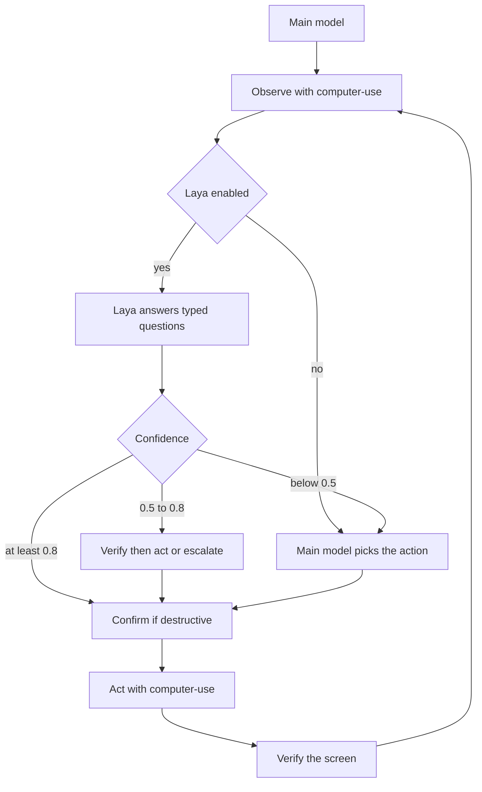

# smart-computer-use

Agent skill for desktop computer use. A harness such as OpenCode, Claude Code, Codex, Cursor, or Gemini CLI loads the skill, observes the screen, and drives the mouse and keyboard through the [`computer-use`](https://github.com/lindoelio/computer-use) CLI.

The CLI is a separate project. This repository is the skill: instructions, setup scripts, and reference docs. There is no Rust code here.

Laya, a local typed decision model, is optional and experimental. The skill works with the CLI and the harness model alone.

## Install

```bash
npx skills add lindoelio/smart-computer-use
```

The installed skill lives in the agent skill directory. On first use the agent runs `scripts/setup.sh` from that directory (or `scripts/setup.ps1` on Windows). The script downloads a release binary of `computer-use` into `~/.local/bin`.

From a clone of this repository:

```bash
bash scripts/setup.sh
bash scripts/check-deps.sh
```

Optional Laya install (does not fail the CLI setup when Laya is unavailable):

```bash
bash scripts/setup.sh --with-laya
```

Pin a CLI release tag with `COMPUTER_USE_VERSION` (`v0.1.0` or `0.1.0`). The default is the latest GitHub release.

Release assets, built by [lindoelio/computer-use](https://github.com/lindoelio/computer-use):

| Asset | Platform |
| --- | --- |
| `computer-use-linux-x64.tar.gz` | Linux x86_64 |
| `computer-use-macos-arm64.tar.gz` | macOS Apple silicon |
| `computer-use-windows-x64.zip` | Windows x86_64 |

Each asset has a matching `<asset>.sha256` file (`<sha256>  <filename>`) and the release also includes `SHA256SUMS`. The archive contains the `computer-use` binary (`computer-use.exe` on Windows) at its root.

If the download or checksum check fails, setup falls back to `cargo install computer-use --locked` when `cargo` is on `PATH`. Rust 1.81 or newer is required to build from source. Otherwise the script prints install instructions and exits non-zero.

## How it works

1. **Observe.** `computer-use get-state` reports displays, cursor, and the frontmost window. `computer-use screenshot` writes a PNG or JPEG.
2. **Decide.** The harness model picks the next action. When Laya is enabled, the model sends a text summary and typed `choice`, `score`, or `noul` questions. Confidence at or above 0.8 may act, 0.5 to 0.8 is verified first, and below 0.5 goes back to the harness model.
3. **Act.** One CLI command clicks, types, presses keys, scrolls, or waits.
4. **Verify.** A new screenshot or state read checks the result.

Destructive and sensitive actions need confirmation from the user before the CLI runs. Details are in [`skills/smart-computer-use/references/security.md`](skills/smart-computer-use/references/security.md).



## Layout

The installable skill is `skills/smart-computer-use/`. `scripts/`, `references/`, and `assets/` at the repository root point at that skill, so `bash scripts/setup.sh` works from a clone. After `npx skills add`, the agent uses the copies inside the skill directory.

```
skills/smart-computer-use/
  SKILL.md
  scripts/     setup.sh, setup.ps1, check-deps.sh, install-laya.sh
  references/  architecture, CLI, Laya, security
  assets/      example-prompts.md
```

## Status

| Phase | Status |
| --- | --- |
| 1. MVP | Skill, setup for macOS, Linux, and Windows, CLI reference, dependency check. The binary is published from [lindoelio/computer-use](https://github.com/lindoelio/computer-use). |
| 2. Laya | Scaffolding: installer, config file, typed question protocol, confidence thresholds. Latency and quality benchmarks are not in this release. |
| 3. Polish | More platform builds, richer logs, examples per harness, security review, optional hosted JEV. |
| 4. Extensions | Native harness plugins and extra backends (Playwright, a fuller accessibility tree) on the same CLI. |

Skill version: 0.1.0. The CLI has its own version. Setup accepts a `computer-use` binary at 0.1.0 or newer unless `COMPUTER_USE_VERSION` pins a tag.

## Permissions

macOS needs Screen Recording for screenshots and Accessibility for input and the accessibility tree. Enable both for the terminal or agent host under **System Settings > Privacy & Security**. Linux support is X11. Wayland is not a supported target of the CLI. Windows needs an interactive desktop session.

`bash scripts/check-deps.sh` reports what it can detect. `bash scripts/check-deps.sh --json` prints the same report as JSON.

## License

[MIT](LICENSE). Copyright 2026 Lindoélio Lázaro.

The `computer-use` CLI is dual-licensed MIT or Apache-2.0. See that repository.
