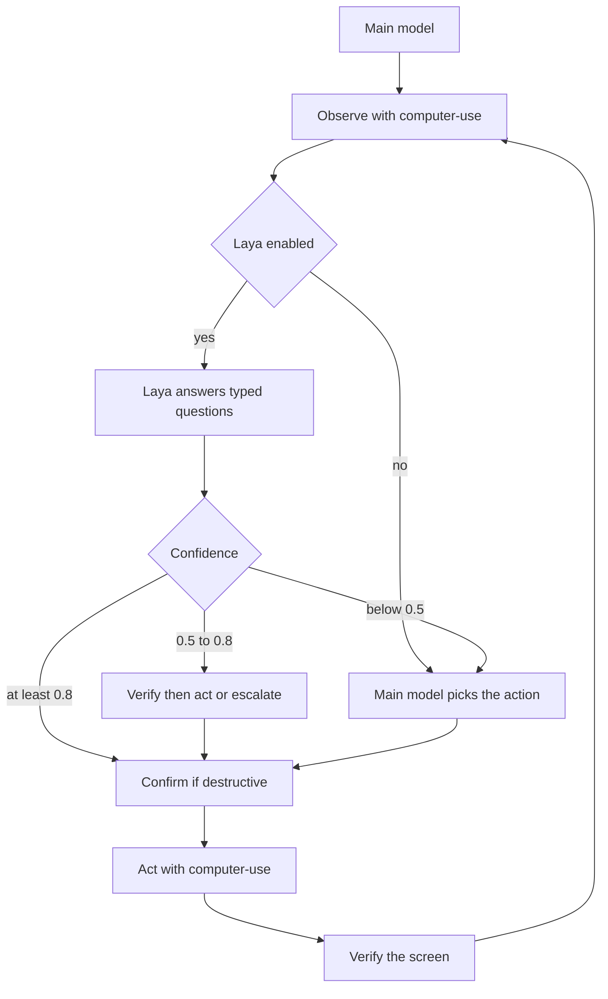

# smart-computer-use

Agent skill for desktop computer use. A harness such as OpenCode, Claude Code, Codex, Cursor, or Gemini CLI loads the skill, observes the screen, and drives the mouse and keyboard through the [`computer-use`](https://github.com/lindoelio/computer-use) CLI.

The CLI is a separate project. This repository is the skill: instructions, setup scripts, and reference docs. There is no Rust code here.

Skill version **0.3.2**, targeting **computer-use 0.3.2**. The CLI is what makes element targeting possible: a numbered accessibility tree per window, acting by element index instead of blind coordinates, the post-action delta in the same call, input tiers, a policy subsystem with an audit log, OCR, and Chrome DevTools Protocol attach.

Laya, a local typed decision model, is optional, experimental, and not measured. The skill works with the CLI and the harness model alone.

## What the loop looks like

1. **Target.** `list-apps` and `list-windows`, then pass `--app` and `--window` on every later command.
2. **Observe.** `tree` returns numbered nodes. Once a baseline exists it returns only the delta.
3. **Act by element.** `press --element 12`, `set-value --element 4`. Coordinates are a fallback for surfaces with no element.
4. **Recover.** `stale_element` means the UI moved. Re-read the tree and re-derive the index; never resend the old one.
5. **Verify.** Read the delta the action returned. Fall back to `ocr` or `screenshot --marks` when the tree is empty.

Every command of a flow carries the same `--session` id. The default session is the process id, so without it the baseline dies between calls and every observation pays for the whole tree again.

`doctor` reports permissions before the first mutating action. `policy check` answers allow or deny without doing anything.

## Install

```bash
npx skills add lindoelio/smart-computer-use
```

The installed skill lives in the agent skill directory. On first use the agent runs `scripts/setup.sh` from that directory (or `scripts/setup.ps1` on Windows). The script downloads a release binary of `computer-use` into `~/.local/bin`.

From a clone of this repository:

```bash
bash scripts/setup.sh
bash scripts/check-deps.sh
```

Optional Laya install (does not fail the CLI setup when Laya is unavailable):

```bash
bash scripts/setup.sh --with-laya
```

### Release selection

Setup prefers `v0.3.2`. It probes the public GitHub releases API (no auth required) and installs `v0.3.2` when that release exists. **When `v0.3.2` is not published yet it falls back to the latest release instead of failing.** A binary older than 0.3.2 is replaced, because the tree, element targeting, batch, browser, and `--state-diff` surface needs it.

Pin a specific release tag with `COMPUTER_USE_VERSION` (`v0.3.2` or `0.3.2`). Reinstall an acceptable version with `--force`.

On macOS the release also ships `Computer Use.app`. Setup extracts it into `~/Applications` and points `~/.local/bin/computer-use` at it, so the macOS permission grant belongs to the app instead of to whatever program started the binary. The bundle is ad-hoc signed and not notarized.

Release assets, built by [lindoelio/computer-use](https://github.com/lindoelio/computer-use):

| Asset | Platform |
| --- | --- |
| `computer-use-linux-x64.tar.gz` | Linux x86_64 |
| `computer-use-macos-arm64.tar.gz` | macOS Apple silicon |
| `computer-use-macos-arm64-app-unsigned.zip` | macOS Apple silicon, the app bundle |
| `computer-use-windows-x64.zip` | Windows x86_64 |

Each asset has a matching `<asset>.sha256` file (`<sha256>  <filename>`) and the release also includes `SHA256SUMS`. The archive contains the `computer-use` binary (`computer-use.exe` on Windows) at its root.

If the download or checksum check fails, setup falls back to `cargo install computer-use --locked` when `cargo` is on `PATH`. Rust 1.91 or newer is required to build from source. Otherwise the script prints install instructions and exits non-zero.

### Optional features

The release binaries enable `portal` on Linux only. Two things need a build from source:

```bash
cargo install computer-use --locked --features cdp
```

- `cdp` enables `browser *`. **No published asset ships it.** It attaches to a Chrome you start yourself with `--remote-debugging-port`; it never launches or quits Chrome.
- `skylight` and `virtual-display` use private macOS APIs. They are experimental, off by default, and fail closed. Most users should not enable them.

## How it works

1. **Target.** Name the app and window.
2. **Observe.** `computer-use tree --session notes --app Notes --window 0`.
3. **Decide.** The harness model picks the element index. When Laya is enabled, the model sends a text summary and typed `choice`, `score`, or `noul` questions. Confidence at or above 0.8 may act, 0.5 to 0.8 is verified first, and below 0.5 goes back to the harness model.
4. **Act.** One CLI command presses or sets a value on an element. `--state-diff` returns the delta in the same call.
5. **Verify.** The returned diff. `stale_element` means re-read, not retry.

Destructive and sensitive actions need confirmation from the user before the CLI runs. The CLI has its own policy layer — `policy.toml`, a confirm hook, an audit log, and pause-on-human-input — and the skill uses it instead of relying only on the model's caution. Details are in [`skills/smart-computer-use/references/security.md`](skills/smart-computer-use/references/security.md).



## Layout

The installable skill is `skills/smart-computer-use/`. `scripts/`, `references/`, and `assets/` at the repository root point at that skill, so `bash scripts/setup.sh` works from a clone. After `npx skills add`, the agent uses the copies inside the skill directory.

```
skills/smart-computer-use/
  SKILL.md
  scripts/     setup.sh, setup.ps1, check-deps.sh, install-laya.sh
              test-setup.sh, test-lint.sh, measure-loop.sh
              gen-cli-surface.py, lint-skill.py
  references/  architecture, CLI, Laya, security, cli-surface.json
  assets/      example-prompts.md
```

## What the skill covers today

| Area | State |
| --- | --- |
| Core loop | Tree indices, `--app`/`--window` targeting, `stale_element` recovery, the `--state-diff` delta in one call, and batch. |
| Safety | Policy file, built-in deny list, confirm hook, audit log, pause on human input, secure-field refusal. |
| Platforms | macOS (live), Windows and Linux (CI only). Setup for all three. |
| Browser | CDP attach, built from source with `--features cdp`. |
| Laya | Optional, experimental, and **not measured**: no latency or accuracy benchmark exists. The default path is the harness model. |
| Verification | The CI compares the documented surface against a real binary, and a test proves the comparison fires on a drift. |

Skill version: 0.3.2. The CLI has its own version. Setup requires a `computer-use` binary at 0.3.2 or newer, or exactly the tag `COMPUTER_USE_VERSION` pins.

The pinned surface lives in `skills/smart-computer-use/references/cli-surface.json`: the commands, the global flags, and the JSON action names the binary accepts. `scripts/gen-cli-surface.py` regenerates it from a binary, and the CI fails when the two disagree.

A quality review of the skill, with the measurements behind it, is in [`docs/quality-analysis-2026-10-20.md`](docs/quality-analysis-2026-10-20.md).

### What one step costs

`scripts/measure-loop.sh` measures the payload of a step against a real window. Measured on 2026-10-20, Chrome, 38,956 characters of numbered tree:

| Mode | Response |
| --- | --- |
| `--state` | 40,226 bytes |
| `--state-diff` | 265 bytes |

The loop reads the delta, so a step costs 265 bytes instead of 40 KB. The command count is one either way.

## Permissions

macOS needs Screen Recording for screenshots and Accessibility for input and the accessibility tree. Enable both for the terminal or agent host under **System Settings > Privacy & Security**. Linux support is X11 plus, with the `portal` feature, Wayland. Wayland is not a supported target of the X11-only build. Windows needs an interactive desktop session.

`computer-use doctor` reports permissions and the exact pane to open. `bash scripts/check-deps.sh` reports what it can detect without changing any grant, and `bash scripts/check-deps.sh --json` prints the same report as JSON. It reports the CLI version as `outdated` when the installed binary is older than 0.3.2, and it reports whether the binary runs inside the app bundle.

The CLI refuses Terminals and Password Managers through a built-in deny list on every platform, refuses secure text fields outright, and can be locked down further with `~/.config/computer-use/policy.toml`.

## License

[MIT](LICENSE). Copyright 2026 Lindoélio Lázaro.

The `computer-use` CLI is dual-licensed MIT or Apache-2.0. See that repository.
