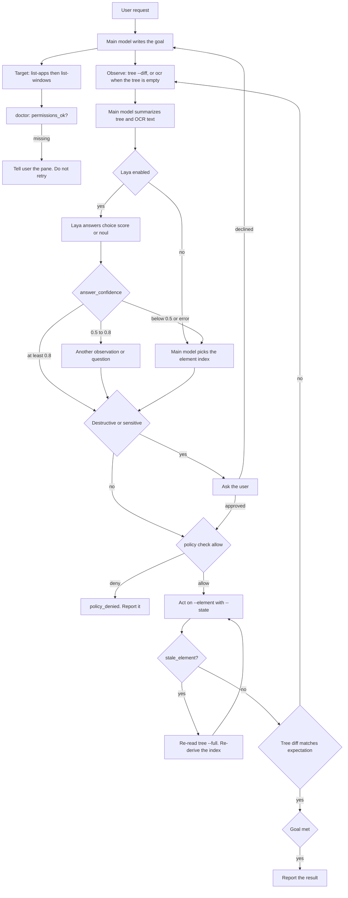

# Architecture

The harness model plans the task. The `computer-use` CLI is the only component that reads the screen and sends input. Laya, when enabled, answers typed questions about a text summary. It does not click, and it does not receive raw pixels.

## Roles

| Piece | Role |
| --- | --- |
| Main model | Plans, targets the app and window, reads the tree, confirms sensitive actions, and takes over when Laya is absent or unsure. |
| Laya | Optional local classifier. One forward pass answers `choice`, `score`, and `noul` questions about the text state. |
| `computer-use` CLI | Discovery, tree, element and coordinate actions, tiers, policy, audit, batch, adapters, and CDP attach. One JSON object per action. |
| Setup scripts | Install the CLI (preferring 0.2.0, falling back to the latest release), optionally install Laya, and report permissions. |

## Three layers of state

| Layer | Owner | Lifetime | Notes |
| --- | --- | --- | --- |
| Goal and plan | Main model | The task | What the user asked for, and the remaining steps. |
| Element tree and revision | CLI session cache | The session | Numbered nodes plus a structural revision. `stale_element` compares against it. |
| Screen pixels | CLI screenshot map | The last capture | `image_to_screen` / `screen_to_image`; `--coord image` reads it. |

The session cache is `${XDG_CACHE_HOME:-~/.cache}/computer-use/sessions/<session>/` (`%LOCALAPPDATA%\computer-use\cache\sessions\<session>\` on Windows), mode `0600` on Unix. `--session <ID>` namespaces it; the default is the process id. `--state` writes a new revision and turns that diff into the next `tree --diff` baseline, which is what makes the loop one call per step.

## Observation order

1. `tree` — numbered, diffable, and actable. Preferred whenever the app exposes accessibility.
2. `screenshot --marks` — when the tree is empty or the target is not in it. Same indices, stamped on pixels.
3. `ocr` — when the content is text the tree does not expose.
4. Coordinates — a last resort, from `image_to_screen`.

`get-state` is orientation, not the main observation: displays, cursor, frontmost app and window, and a `note` explaining any `null`.

## Action layer

Element actions (`press`, `set-value`, `select-text`, `perform-action`, `scroll-to`, `focus`, `click --element`) resolve an index through the session cache, revalidate it, and act. Coordinates hit-test first, then post.

Tiers decide how much of the session is disturbed:

| Tier | Mechanism | Takes `foreground.lock` | Moves the cursor |
| --- | --- | --- | --- |
| `ax` | Accessibility action or value | no | no |
| `event` | Post events to the target pid | no | no (reports `cursor_moved`) |
| `activate` | Activate, foreground input, restore previous app | yes | yes |
| `synthetic` | Private SkyLight front-process call, then post | no | no |

`--require-background` refuses the `activate` fallback and turns cursor motion into `execution_failed`.

## Safety layer

Policy, confirm hook, audit, and pause live in the CLI, not in the model:

- `policy.toml` (user and admin) plus a built-in deny list for terminals and password managers. Deny wins; admin allow entries do not grant.
- A confirm hook for sensitive actions, returning `confirm_required` or `confirm_denied`.
- An append-only `audit.jsonl` recording `decision`, `source`, `code`, and sizes — never text, never script bodies.
- A listen-only `CGEventTap` that flips `paused` when a human touches the machine.

The model's own confirmation loop sits in front of all of it. Neither replaces the other: the model asks, the CLI enforces. See [security.md](security.md).

## State crossing the boundary

`tree` returns numbered text; `ocr` returns recognized text. Put the goal, that text, and the observed diff into Laya's `state`. Keep the decisive facts first. Laya reads a limited token budget (512 tokens on the English checkpoint, 1024 on the multilingual checkpoint).

The CLI does not read `~/.config/smart-computer-use/config.json`. The agent reads that file and the `SMART_COMPUTER_USE_LAYA*` environment variables, calls Laya itself, and then shells out to `computer-use`.

## Failure edges

- `"ok": false` — read `error.code`, never the message text. It is the stable contract.
- `stale_element` — the UI moved under a cached index. The body carries the new tree. Re-derive the index; do not resend the same one and do not route around it with coordinates.
- `element_not_found` — the index is not in the tree at all, or there is no session cache. Run `tree` first.
- `permission_required` — a grant is missing, not an argument. Run `doctor`, tell the user which pane, and stop. Retrying changes nothing.
- `policy_denied` — the built-in list or a policy file refused it. Do not look for another route.
- `confirm_required` / `confirm_denied` — no hook, or the hook said no. Ask the user.
- `paused` — a human is at the keyboard. Wait, or `resume` if they told you to.
- `display_unavailable` — the screen is locked or the display is asleep.
- `doctor` exits 0 with `permissions_ok: false` — branch on `permissions_ok`, never on the exit code.
- `unsupported` vs `cdp_unavailable` — the browser feature is missing versus Chrome not attachable.
- Laya timeout, process error, or JSON that is not the documented answer shape — drop Laya for that step and let the main model decide.
- Verification mismatch — return to observe. Do not fire the same action again without a new observation.