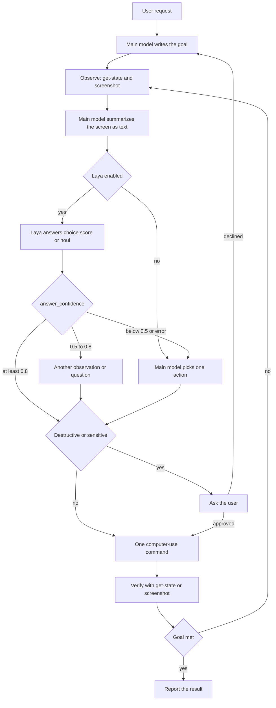

# Architecture

The harness model plans the task. The `computer-use` CLI is the only component that reads the screen and sends input. Laya, when enabled, answers typed questions about a text summary. It does not click, and it does not receive raw pixels.

## Roles

| Piece | Role |
| --- | --- |
| Main model | Plans, summarizes the screenshot, confirms sensitive actions, and takes over when Laya is absent or unsure. |
| Laya | Optional local classifier. One forward pass answers `choice`, `score`, and `noul` questions about the text state. |
| `computer-use` CLI | Screenshot, click, move, type, key, scroll, wait, displays, and `get-state`. One JSON object per action. |
| Setup scripts | Install the CLI, optionally install Laya, and report permissions. |

## State crossing the boundary

`get-state` returns platform, displays, cursor, frontmost app, frontmost window, a best-effort accessibility tree, and a `note`. Put the goal, those fields, and a short description of the screenshot into Laya's `state`. Keep the decisive facts first. Laya reads a limited token budget (512 tokens on the English checkpoint, 1024 on the multilingual checkpoint).

The CLI does not read `~/.config/smart-computer-use/config.json`. The agent reads that file and the `SMART_COMPUTER_USE_LAYA*` environment variables, calls Laya itself, and then shells out to `computer-use`.

## Failure edges

- CLI `"ok": false` — do not guess a success. Read `error.code`. `execution_failed` on macOS is often a missing Accessibility or Screen Recording grant.
- `get-state` with `"ok": true` and `accessibility: null` — input or the tree may still be blocked. Read `note`.
- Laya timeout, process error, or JSON that is not the documented answer shape — drop Laya for that step and let the main model decide.
- Verification mismatch — return to observe. Do not fire the same click again without a new observation.
